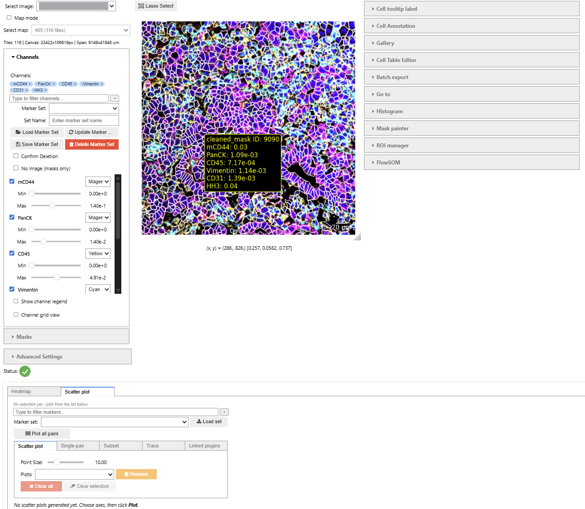

# User Interface

This page is a reference map of the UELer interface — the four main regions and the controls in each.
For a hands-on first run, see [Basic Usage](basic-usage.md).



---

## Layout Overview

The left panel's accordion is **built from your data**: the **Channels** section is always there,
**Masks** appears only if `masks_folder` yielded readable masks, and **Pixel annotations** only if
`annotations_folder` did. A section you cannot find is usually a path that did not load rather than a
setting to switch on.

| Region | Location | Contents |
|---|---|---|
| **Left panel** | Left column | FOV selector, channel / mask / annotation controls, marker sets, advanced settings |
| **Main viewer** | Center | Image canvas, lasso toggle, zoom/pan, scale bar |
| **Right panel** | Right column | Plugin tools (accordion) |
| **Footer** | Bottom | The wide plugins — **Scatter plot** and **Heatmap** |

Plugin placement is fixed, not adaptive: each plugin lives in either the right-panel accordion or the footer, and never moves between them. The **Scatter plot** and **Heatmap** are footer-only because both need the full window width to be readable, so they are absent from the accordion entirely — look for them at the bottom of the viewer, not on the right.

---

## Left Panel

### Top controls

- **Select Image:** — choose the active FOV. The ◀ and ▶ buttons beside it step to the previous or next FOV in the list; each is greyed out at its end of the list.
- **Cache Size:** — number of FOVs kept in memory at once (default 100).

### Channels

- **Channels:** — a searchable picker for the visible channels. Click the field to browse the full
  scrollable list, type to filter it (case-insensitive), and use **Select all shown** to take a
  whole filtered group at once or **Clear** to drop everything. Keyboard: ↑/↓ move, Enter toggles,
  Esc closes, Backspace on an empty filter box removes the last selection.
- **Reordering the selection** — each selected channel appears as a chip. Drag a chip by its `⋮⋮`
  grip to move it; a blue bar marks where it will land, and dropping past the last chip sends it to
  the end. You can also click a chip and press ← / → to move it, or Delete to remove it. The order
  is applied to the per-channel controls below and to the order channels are composited in.
- Per-channel **color** dropdown, visibility checkbox, and **Min** / **Max** contrast sliders — one
  row per selected channel, listed in the order of the chips above. Reordering the chips reorders
  these rows and keeps each channel's colour and contrast settings.
- **Show channel legend** — display a color key for the visible channels.
- **Channel grid view** — render each visible channel as its own labelled pane in a synchronized grid.

### Masks

A separate accordion section, present **only when `masks_folder` contained readable masks**:

- **Mask &lt;name&gt;** dropdowns + enable checkboxes — one row per mask layer, each with a single
  uniform colour.
- **Mask outline px:** — outline thickness, applied to every mask layer.

For per-class fill/outline, opacity, continuous colour scales, and saved palettes, use the
**Mask painter** plugin instead.

### Marker Sets

Save and restore named channel/color/contrast combinations: **Marker Set:** dropdown, **Set Name:**
input, and **Load / Save / Update / Delete Marker Set** buttons. **Delete Marker Set** opens a confirmation dialog naming the set before anything is removed (#139).

### Pixel annotations

Also its own accordion section, visible when `annotations_folder` contains valid rasters:

- **Show annotation** — toggle the annotation overlay.
- **Annotation:** — choose which annotation to display.
- **Fill alpha:** — overlay transparency.
- **Legend labels:** — show class IDs or text labels.
- **Edit palette…** — customize per-class colors (with save/load of `.pixelannotations.json` sets).

### Advanced Settings

Two tabs inside one accordion section. The second tab is itself split into collapsible sections:

- **Data mapping** — **X key:**, **Y key:**, **Label key:**, **Mask key:** and **Fov key:**, the names
  that link your cell table and your masks to the images. Each is a text field with a **suggestion
  list built from your own data**: the four cell-table keys offer the columns your table actually has
  (**X key:** and **Y key:** offer the numeric ones), and **Mask key:** offers the mask suffixes found
  in your masks folder. So you normally pick rather than spell — and you can still type a name the
  list does not contain, which is what keeps the field usable when discovery comes up short. Without
  a cell table the four column fields keep their defaults, since there is nothing to offer yet. See
  [Guided Setup](setup-dialog.md#the-key-fields-are-suggestion-lists-not-menus).
- **Advanced Settings**
    - **Display and performance** — **Cache Size:**, the **Pixel Size (nm):** input that drives the [scale bar](#main-viewer), a **Downsample** toggle, and **Frame format:**, which picks how the viewer's image reaches your browser (PNG, or the smaller JPEG / WebP for remote sessions; see [Display Settings](display-settings.md#remote-sessions-frame-format)).
    - **Selection and colours** — **Selection colour** (amber by default), **Selection outline (px)**, **Selection fill**, **Default mask colour** and **Plot base colour**. See [Display Settings](display-settings.md#selection-and-colours).

!!! note "You are asked for these on first load"
    A [setup dialog](setup-dialog.md) opens the first time you load a dataset and
    walks you through whichever of these apply to what you loaded. It edits these same fields, so
    anything you set there is already applied here.

---

## Main Viewer

- **Image canvas** — the composited multi-channel image with any active overlays.
- **Selecting cells with the mouse:**
  - **Click a cell** to select only that cell.
  - **Ctrl + click a cell** to add it to the selection, or take it out if it is selected.
  - **Ctrl + drag** to draw a lasso loop straight away, without the **Lasso Select** toggle.
  - **Shift + click a cell** to put it in the [active cart](cell-sets.md#carts-collecting-cells-over-time), or take it out if it is in the cart. The selection does not change. With no active cart, the bar says so.
  - **Right-click the background** (outside any cell) to unselect everything, as **✕** does but without asking; **Undo** (↶) in the selection bar brings the selection back.
  - **A left click on the background does nothing**, so a mis-click never loses a selection.
  
  Every one of these is a step in the session's [selection history](cell-sets.md#going-back-to-an-earlier-selection).
- **Lasso Select** (top of the viewer) — a one-shot toggle: draw a freehand loop to add every cell with part of its mask inside it to the selection. A loop around cells that are all selected already unselects them instead; a loop that also reaches unselected cells adds those, so a larger loop extends a selection. Only the masks ticked under **Masks** are searched, so show one first. The toggle resets itself after each loop, and the selection bar beside it shows the result, or why there was none. **Ctrl + drag** draws the same loop without the toggle.
- **Zoom and pan** — scroll to zoom, drag to pan.
- **Scale bar** — computed from the **Pixel Size (nm):** value when available (there is no separate
  on/off toggle; set the pixel size to 0 to omit it).
- **No image (masks only)** — hide the channel image to inspect overlays on a blank background.

### The selection bar

The row with **Lasso Select** also shows the current cell selection, whichever view made it: a click or lasso in the image, a scatter lasso, a histogram gate, or a heatmap cluster sent to the Gallery. The most recent selection wins.

```
[Lasso Select] [↶] [↷]  23 cells · histogram gate · 23 in this FOV, not outlined in the image   [Image] [Gallery ✓] [Plots] [+ Cart] [− Cart] [Save as set…] [✕]
```

- **Undo ↶ / Redo ↷:** step back and forward through this session's selections; going back puts the earlier selection where the current one was shown. See [Cell Sets](cell-sets.md#going-back-to-an-earlier-selection).
- **The text:** how many cells, where they were selected, and how many are in the FOV shown (left out in map mode). "Not outlined in the image" means the selection went elsewhere, for example straight from a histogram to the Gallery.
- **Image:** outlines the cells in the image.
- **Gallery:** shows them in the Gallery.
- **Plots:** selects them in the scatter plot and histogram.
- **+ Cart / − Cart:** add the selection to the [active cart](cell-sets.md#carts-collecting-cells-over-time), or take it out. Shown only while a cart is active; the tooltip names it.
- **Save as set…:** keeps the selection as a named cell set with tags; the bar shows a name field and a tags field in its place until you save or cancel. Shown when a cell table is loaded. See [Cell Sets](cell-sets.md).
- **✕:** unselects everything: the image, the plots, the Gallery and the bar. It asks first; **Undo** brings the selection back.

A button with **✓** shows the selection already, through a link box or an earlier click. Click it again to take the selection back out of that view; the selection itself stays in the bar, so you can send it there again. The button of the view the selection was made in shows **✓** greyed out: you cannot unlink a selection from where it was made, only unselect it with **✕**. The buttons act once; the **Linked plugins** boxes in each plot keep forwarding every new selection automatically, so a view you unlinked receives the next selection from a linked plot again. A selection made in the image belongs to its FOV and is cleared on a FOV switch; one from a plot stays, and the bar's FOV count follows the FOV shown. The same row carries messages, such as the lasso instructions or why a loop or **Trace** found no cells.

---

## Right Panel (Plugins)

Plugins appear as an accordion. **Which plugins load depends on whether a cell table is present:**

- **Without a cell table**, only these two load — both work on images alone:
    - **ROI manager** — capture, tag, draw, and browse regions of interest. See [Regions of Interest](roi-manager.md).
    - **Batch export** — export FOVs, ROIs, and single-cell crops. See [Batch Export](export.md).
- **With a cell table loaded**, the analytical plugins also appear:
    - **Histogram** — linked per-channel distributions. See [Scatter & Histogram](scatter-histogram.md).
    - **Gallery** — thumbnails of the currently selected cells.
    - **FlowSOM** and **Cell Annotation** — clustering and checkpoints. See [Clustering & Annotation](clustering-annotation.md).
    - **Mask painter** — per-class mask colors, fill/outline modes, opacity, and saved palettes.
    - **Go to** — jump and zoom to a specific cell.
    - **Cell sets** — save selections as named, tagged sets and write values into the cell table. See [Cell Sets](cell-sets.md).
    - **Cell tooltip label** — choose which cell-table columns appear in the hover tooltip.

!!! note "Two plugins are not in this list"
    **Scatter plot** and **Heatmap** also require a cell table, but they live in the
    [footer](#footer-wide-plugins) rather than the accordion. Do not go looking for them on the right.

!!! note "Panel order"
    The right-panel accordion order is not curated — locate a plugin by its name rather than its
    position.

---

## Footer (Wide Plugins)

Two plugins are allocated permanently to the horizontal footer panel, so the main viewer stays visible above them. Neither appears in the right-panel accordion, and neither has a toggle for moving it — the placement is not a preference:

- **Scatter plot** — single-pair and all-pairs scatter matrices. A triangular matrix of scatters is unreadable at side-panel width, which is why the plugin lives here whether one scatter is active or twenty. See [Scatter & Histogram](scatter-histogram.md).
- **Heatmap** — the cluster × marker heatmap, always drawn in its wide (horizontal) orientation. See [Clustering & Annotation](clustering-annotation.md).

Both require a cell table, so the footer is empty until one is loaded.
